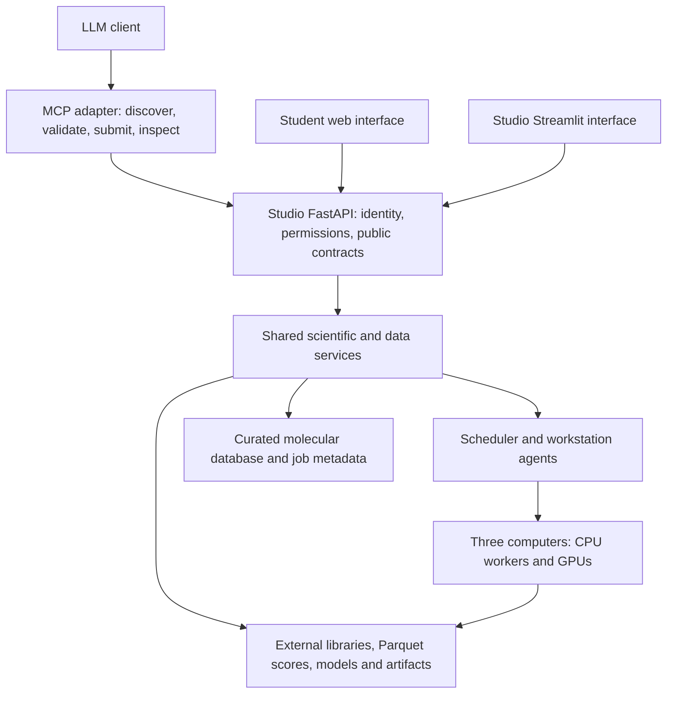

# Studio API coverage and agent/student integration

Audited: 2026-10-26. Code revision: `db6fb798c04ae9b5ac86cec6ccc2e063fc8e3d94`.

This is the pre-implementation snapshot. See [REST and MCP integration](api-and-mcp.md)
for the subsequent implementation and rollout boundaries.

## Conclusion

The proposed architecture is suitable: an LLM uses an MCP adapter, and the MCP
adapter and student web interface use the same Studio REST API. The scientific
execution layer already supports much of this. The API does **not** yet cover
every operation available in the Studio interface.

Streamlit currently also calls Python services and stores interaction state
directly. The diagram describes the intended architecture, rather than a fully
implemented separation between all clients and the backend.

## Intended data flow



The following details matter:

- Authentication and project permissions belong in the backend and are required
  for student access. MCP is a client adapter, not a second scheduler or database.
- Both CPU and GPU resources run docking, depending on the engine. Preparation,
  fingerprinting, NN training, inference and analysis also have distinct resource
  requirements; the scheduler assigns them.
- Long tasks return job IDs promptly. Clients poll status and retrieve results;
  the scientific process continues independently of the client connection.
- Clients identify libraries, structures and artifacts by stable references.
  Server paths remain implementation details where practical.
- Target and ligand remain separate molecular records with a pose/target link.
  Viewing or preparing a bound complex composes their coordinates for that use.
- Large libraries and complete screening tables remain external. The database
  contains their descriptors and links, and at most the explicitly selected final
  screening shortlist of 0–1,000 compounds.

## Verified inventory

| Check | Finding |
| --- | --- |
| Live REST paths | 72 |
| HTTP operations | 76 |
| Internal machine operations within that count | 14 |
| Registered scientific workflow adapters | 113 |
| Distinct workflow IDs referenced by the Tools catalogue | 75 |
| Those 75 IDs missing from the API catalogue | 0 |
| Workflow schema requests | 113/113 successful |
| Pipeline node catalogue | 83 node types, including 11 active learning types |
| Focused existing pytest tests | 63 passed, 189 deselected |

These are discovery, contract and selected integration checks, not successful
scientific runs of all 113 adapters. Tests used isolated fixtures; this audit did
not launch docking, training, MD or library preparation jobs.

The live completed campaign's results endpoint returned eight rounds, stopping
criteria, convergence summaries and a 100-row preview for 1,590,790 scored
compounds. The complete results remain in external Parquet.

The machine endpoints use node credentials checked in route dependencies. Their
lack of an OpenAPI bearer-security declaration does not mean they are public.
They must not be exposed as ordinary student or LLM tools.

Machine-readable route inventory:
`api-parity-inventory-20261026.json` beside this document.

## Coverage matrix

All endpoint paths below are relative to `/api/v1`.

| Area | Existing API | Remaining work for parity |
| --- | --- | --- |
| Scientific tools | `/workflows`, per-workflow `/schema`, `/validate`, submission | All catalogue workflow IDs are discoverable. Catalogue presence does not guarantee every tile's preparation helper or input preset has an HTTP equivalent. |
| Pipeline graphs and AL loops | `/pipelines/catalog`, `/save`, list, `/validate`, `/run`; completed-run adoption and undo | Historical revision listing/retrieval has no route. Current graphs and revision hashes are returned. Interactive editor state is still in Streamlit. |
| Distributed jobs | Cluster nodes, placement preview, submission, job list/inspection, command polling | Local and cluster jobs have different lookup/response patterns. A shared client or unified public job contract should hide this. |
| Job actions and files | Local cancellation; cluster inspect, artifact, cancel, hide, restore, limited retry, GPU change, purge and MD source options | The action endpoint's retry is specifically for a failed workstation acceptance compatibility check, not a general scientific rerun. Add typed action discovery/documentation. |
| Accounts/projects | Login, current user, logout, password change; accessible project listing and project creation | Account creation, password reset, disabling accounts and granting/revoking project access are UI/Python operations with no user administration API. |
| Molecular records | Import, search, pagination, groups, membership addition, metadata, structure download/materialization, evaluation search and comparisons | Membership removal, group project reassignment and chain-role editing lack routes. |
| Import review/history | Direct imports and basic parser validation | UI import analysis/review, duplicate reports, import batch rows and original import-source retrieval lack equivalent routes. |
| Molecular selections/exports | Compound snapshots, protein selections, saving selected run molecules, individual structure files | The UI CSV, FASTA, SMILES, SDF and structures-ZIP export service has no general export endpoint. Snapshots are not equivalent to all those exports. |
| External libraries/centroids | `library.prepare` and `library.centroids` job adapters | No public library catalogue/list/detail/register/preparation-lineage API. Raw external-library path registration is admin-only; sharing approved libraries with students needs an explicit access contract. |
| Bulk screening results | Job results include bounded previews, round summaries, score metadata, stop reason and external table paths | No paginated external-score query/rank/filter endpoint or explicit bounded final-shortlist import endpoint. Full-file download is a partial workaround subject to transport limits. |
| Bound docking pose to MD | Target and pose context are stored; individual structures can be retrieved; MD workflows can be submitted | The existing validated `prepare_bound_inputs` operation is not exposed over HTTP. The UI handoff also changes Streamlit session state. |
| Docking setup presets | Full engine parameters can be submitted | Saved docking preparation states are accessed directly by UI/Python, without API list/save/get operations. |
| Plots/viewers | Results and convergence data, metric/evaluation rows and structure files are available | Viewers can be built from these. There is no general API for the complete UI's chart state or rendered report/figure exports; do not assume screenshot/render parity. |
| Settings/resource administration | Node discovery, enrollment, rename and disabling | Storage/settings preferences and other workstation configuration are not fully exposed through the Studio API. No per-user workflow allowlist, submission quota or resource budget policy was found in the inspected public API/dispatch code. |
| LLM integration | REST discovery, validation, submission and inspection provide the foundation | No Studio MCP server or agent tool adapter is implemented in this checkout. |

## Concrete integration issues

### Public input/output contracts

The workflow schema endpoint returns useful parameter descriptors, such as
`pathlib.Path | None`, defaults and required flags. It is not directly an MCP
`inputSchema`. The adapter must produce valid JSON Schemas and preserve the
backend's validation; parameters such as engine modes need explicit choices
where those are currently validated outside the descriptor.

Molecular import accepts inline/base64 data with its own 100 MB limit. Generic
cluster staging uploads and single-artifact downloads have a 512 MiB limit.
That is not a limit on the size of an external library: dedicated library jobs
operate on data-local paths and have a separate output-transfer protocol.
Student uploads need a documented file-reference/staging contract, and large
results need paginated queries or streaming/chunked downloads. Loading a whole
library into molecular imports would violate the intended storage design.

### Identity and deployment

The current live API listens on `127.0.0.1:8766`; a request without Authorization
returned an admin identity. This is appropriate to the current local development
setup, not a student deployment. Production authentication must be enabled and
checked with separate instructor/student accounts before exposing it.

The API already implements owner/project access checks, and the selected tests
exercise access boundaries. User administration remains in the UI. No CORS
middleware is installed: a separate-origin student browser client needs an
explicit CORS configuration or, preferably, a same-origin application gateway.
Keep user tokens distinct from internal workstation credentials.

### Retries and long-running work

Cluster submissions already support per-owner idempotency keys and reject a
changed payload reused under the same key. The direct local workflow/pipeline
paths do not provide the same request-level guarantee; scientific scheduler
deduplication is not a substitute for a uniform public retry contract.
The public interface should consistently return a job ID and make repeated
requests safe across local and remote placement. Polling is currently the
available status mechanism; a separate event stream is optional.

## Recommended implementation order

1. **Complete the shared data API.** Add external library discovery/lineage with
   access checks, external screening result queries, bounded final shortlist
   import, molecular exports and validated bound-pose MD input preparation.
   Reuse existing Python services rather than reimplementing chemistry in MCP.
2. **Complete user/project administration and public contracts.** Add account and
   project-grant endpoints, stable artifact/upload references, uniform job and
   retry behavior, historical pipeline revision access and resource policies
   appropriate for student use.
3. **Add a thin MCP adapter.** Start with discovery, schema, validation,
   submission, job status/cancellation, result queries, structure retrieval and
   prepared MD inputs. Forward the user's identity to REST. Keep machine
   administration outside the normal scientific tool set.
4. **Build the student web client on that same API.** Project-scoped tool forms,
   editable pipelines, job/iteration progress, convergence plots, molecular
   viewers and selected exports. Gradually move matching Streamlit actions onto
   the same contracts.
5. **Verify complete API-only journeys.** Test student login → input import or
   approved library selection → validation → scheduled workflow/pipeline →
   status → result query → selected export/DB promotion → bound-pose MD setup.
   Cover local/remote execution, inaccessible projects, duplicate submissions,
   cancellation and large-result pagination with fixtures before another
   computational smoke run.

## Evidence locations

- `mn_molecular_design_studio/api.py`: public workflow, pipeline and local job routes.
- `mn_molecular_design_studio/molecular_database_api.py`: molecular HTTP routes.
- `mn_molecular_design_studio/cluster/routes.py`: public cluster and internal node routes.
- `mn_molecular_design_studio/cluster/service.py`: placement and admin-only external path registration.
- `mn_molecular_design_studio/cluster/store.py`: job actions and submission idempotency.
- `mn_molecular_design_studio/cluster/bundles.py`: generic staging limits.
- `mn_molecular_design_studio/cluster/agent.py`: artifact retrieval and worker execution.
- `mn_molecular_design_studio/external_libraries.py`: library catalogue and preparation lineage.
- `mn_molecular_design_studio/bulk_screening_results.py`: external results and bounded final import.
- `mn_molecular_design_studio/bound_docking.py`: validated target/pose preparation for MD.
- `mn_molecular_design_studio/molecule_exports.py`: general molecular exports.
- `mn_molecular_design_studio/pipeline_graph.py`: graph persistence and historical revisions.
- `mn_molecular_design_studio/database_selections.py`: current Streamlit handoffs.
- `mn_molecular_design_studio/run_app.py`: catalogue and user/settings administration.

Focused verification command:

```bash
python -m pytest -q tests/test_cluster.py tests/test_cluster_integration.py tests/test_peer_workstations.py tests/test_molecular_database_integration.py tests/test_evaluations_and_comparisons.py tests/test_pipeline_graph.py tests/test_workflow_queue_lifecycle.py tests/test_output_vocabulary.py -k 'api or auth or permission or access or owner or forbidden or project or token'
```

Result: 63 passed in 3.66 s. One existing Starlette/httpx deprecation warning.
