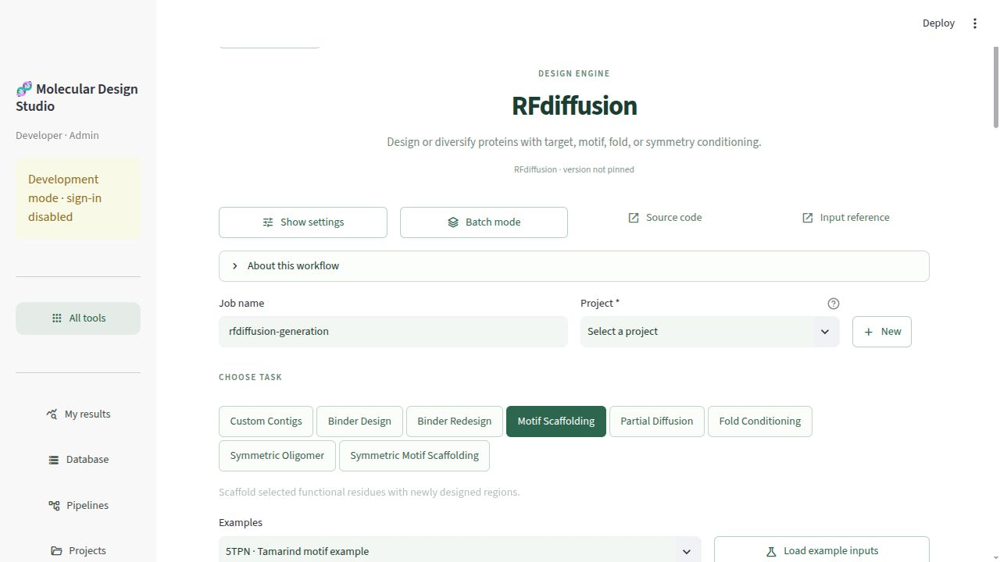

# Generator tool pages and pipeline templates

Implemented 2026-10-17. These four catalog tiles perform **generation only**.
Sequence redesign and folding are explicit canvas steps. Existing native
pipeline workflow IDs remain available for historical API jobs and saved graphs.

| Tile | New workflow | Tasks | Bundled examples |
| --- | --- | --- | --- |
| PXDesign | `design.pxdesign_generate` | Binder design | 2 |
| RFdiffusion | `design.rfdiffusion_generate` | Custom contigs; binder design; binder redesign; motif scaffolding; partial diffusion; fold conditioning; symmetric oligomer; symmetric motif scaffolding | 12 |
| Genie3 | `design.genie3_generate` | Binder design; unconditional generation; motif scaffolding | 42 |
| Protpardelle-1C | `design.protpardelle_generate` | Binder design; unconditional generation; motif scaffolding; partial diffusion; multichain generation | 53 |

## Forms

Standalone pages and node dialogs share `generator_ui.render_inputs`. They use
green task buttons, a task-specific example selector, PDB/mmCIF import, structure
and residue selection, sampling controls and optional settings. Examples are
copied into the current user's private input directory. Every submission needs a
project. Independent batch jobs use the existing API and scheduler.

RFdiffusion exposes its native contig/checkpoint/noise/potential/fold controls.
Genie3 exposes its direction scale, conditioning strategy, length increments and
compilation switch. PXDesign exposes diffusion steps, precision and fast layer
normalization. Protpardelle exposes published model checkpoints, sampling churn,
step scale, crop conditioning, translation, batching and partial diffusion.

Tamarind references inspected:

- [PXDesign](https://app.tamarind.bio/tools/pxdesign): 1CRN, chain A, hotspot
  residues 12–33, binder length 10.
- [RFdiffusion](https://app.tamarind.bio/tools/rfdiffusion): all eight task
  controls; public 5TPN motif example retains A30–40 and A60–70 with a
  19-residue designed segment.
- [Genie3](https://app.tamarind.bio/tools/genie3): 1IEP, chain A, hotspots
  261/263/264, binder length 80–120, five samples and direction scale 0.
- The attempted Protpardelle-1C tool URL redirected to the Tamarind homepage.
  Its form uses the same visual layout with upstream native task configurations.

Unavailable Tamarind-specific optimization modes are not presented as installed
engine capabilities. Coordinate examples and licenses are attributed in
`assets/generators/README.md`.

## Native execution

- PXDesign runs `check-input`, `parse-target` and `infer`; it does not run its
  combined evaluation pipeline or request target MSAs during generation.
- Genie3 runs `generate`, without evaluation, reward models or search wrappers.
- Protpardelle runs `protpardelle.sample --num-mpnn-seqs 0`, which disables its
  external ProteinMPNN and ESMFold evaluation. Internal MiniMPNN remains part of
  the all-atom generation models where required by the upstream architecture.
- RFdiffusion runs the native inference script with validated Hydra arguments.
  Both numeric and native residue selections are checked before job creation.
  Seeds and resolved checkpoint choices are recorded in job inputs.

Installed images are reused: `mn-pxdesign:cu128`, `mn-rfdiffusion:latest`,
`mn-genie3:cu128`, and `mn-protpardelle-1c:cu128`. The tile metadata identifies
code revisions where available; RFdiffusion's image does not pin one.

The fold-conditioned RFdiffusion and symmetric motif checkpoints were missing
and were downloaded from the authors into the common reference folder:

- `rfdiffusion_models/Complex_Fold_base_ckpt.pt`
- `rfdiffusion_models/Base_epoch8_ckpt.pt`

Their source URLs and locally calculated SHA256 hashes are in
`rfdiffusion_models/studio-generator-checkpoint-provenance.json`. No checkpoint
is included in the app package.

## Canvas templates

| Starting template | Explicit downstream steps | Upstream reference |
| --- | --- | --- |
| PXDesign | ProteinMPNN, then separate AF2 Initial Guess and Protenix branches | [Extended evaluation](https://github.com/bytedance/PXDesign#-quick-start) |
| RFdiffusion | Two ProteinMPNN sequences, then target-templated AF2 Initial Guess | [Binder sequence design](https://github.com/RosettaCommons/RFdiffusion#sequence-design-for-binders) |
| Genie3 | One ProteinMPNN sequence, then AF2 Initial Guess with five models and 20 recycles | [Binder design](https://github.com/aqlaboratory/genie3#application-3-binder-design) |
| Protpardelle-1C | Eight ProteinMPNN sequences, then ESMFold | [Sampling](https://github.com/ProteinDesignLab/protpardelle-1c#sampling) |

These are editable starting templates. Studio uses its existing AF2 Initial
Guess adapter where Genie3's authors use ColabFold template evaluation. The
RFdiffusion template uses the authors' supported ProteinMPNN option without
FastRelax. AF2 defaults to single-sequence prediction; cached target MSA plus
ColabFold fallback can be selected in its node settings. Protenix uses its
existing shared target MSA preparation. Binder MSAs are not introduced by these
generators. For unconditional tasks, select a suitable monomer folding step.

## Result handoff

Generated structures are normalized at `generation.backbone`, without claimed
filter passes, binder sequences or folding confidence. “Continue on pipeline
canvas” selects an explicit generated-backbone source scoped to the same project.
The successful-design selector retains its existing requirement for actual
filter-passing designs.

Native RFdiffusion B factors, Genie3 motif annotations and Protpardelle placement
tables provide fixed residue mappings for downstream MPNN. Known motif identities
are checked; missing or malformed mappings block sequence redesign for that
structure. Backbone-only UNK motifs constrain geometry without pretending their
amino-acid identities are fixed. Target chain matching considers only selected
target chains, including when the source contains an unchanged binder.

## Verification

- Full pytest: **382 passed**, one existing Starlette/httpx deprecation warning.
- CPU-only tests cover all 109 bundled input examples and native command/config
  construction; every task form loads a valid example; all four node dialogs use
  the shared form; API preflight, project access, chain roles, motif handoffs and
  legacy pipeline availability are checked with mocked execution.
- Canvas production build passed. Wheel build passed and includes all 259
  generator assets, including nested example directories.
- All examples' required local reference paths were available at review time.
- Both Studio APIs were refreshed and expose all four new workflow schemas.
  The existing scheduler was left running.
- **No GPU inference or smoke tests were run.** Native runtime behavior and the
  complete generation → redesign → folding paths await the user's later smoke
  tests. V7 campaign state and existing job queues were not changed.
