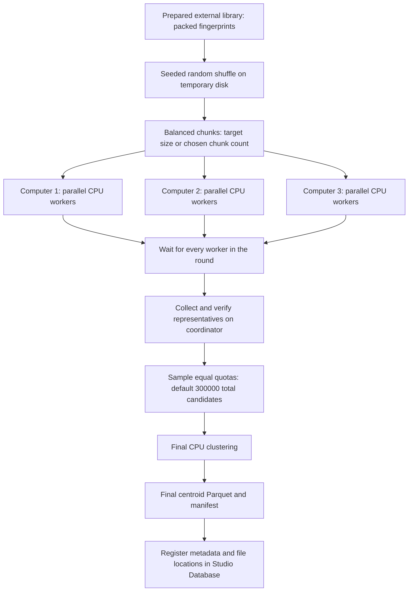

# CPU centroid preparation

The **Create centroids** tile starts from a registered external fingerprint
manifest. Its default method clusters random balanced chunks, samples a fair
quota of representatives from each chunk, then clusters those candidates once.

The number of computers is selectable. Defaults use the currently available
scheduler CPU slots on each selected machine. One Studio job coordinates the
work; remote worker groups acquire their own scheduler CPU leases. Several
chunks run as separate processes on each computer. When fewer chunks remain,
OpenMP threads work inside each chunk. Input/output transfers run through SSH
using the Studio Conda environment on each worker.

## Fingerprint compatibility

Keep the prepared bit vectors unchanged. The preparation tile uses RDKit
feature Morgan fingerprints, radius 2, 1024 bits, `useFeatures=True`, and
`useChirality=True`, matching the OpenVS preparation helper. Its modern
generator equivalent includes `includeChirality=True` and feature atom
invariants. Fingerprint settings and the RDKit version remain in the manifest.

## Chunk and merge settings

- Default target chunk size: 300,000 compounds. There is no library row cap.
- Automatic chunk count: ceiling of input rows / target size. For 100 million
  rows this is 334 chunks of 299,401 or 299,402 compounds.
- Alternatively choose the number of chunks. Chunk sizes differ by at most one.
- Default final comparison: at most 300,000 sampled local representatives.
  Equal quotas are redistributed when a chunk has fewer representatives.
- Optional **merge all representatives** mode retains all local representatives
  into further randomized rounds. Zero maximum additional merge rounds means
  continue until one chunk remains or a round produces no reduction.
- The serial global reference method remains available.

Within each chunk, best-first sphere exclusion orders compounds by increasing
molecular weight, then source compound key. A native packed-bit prefix index
filters impossible matches without discarding true threshold matches. Parallel
query batches retain the same ordered first-match decisions as the serial rule.
No full pairwise distance matrix is created.

Chunking is approximate at library scale. Sampling can omit original clusters;
hierarchical merging can move an original compound beyond the threshold from
its final representative. Both limitations are recorded in the manifest and
explained in the tile. Sampled-mode final cluster sizes count sampled
representative candidates; hierarchical-mode sizes aggregate original source
populations.

## Storage and transfer

Original library files and prepared fingerprints stay in place. Workers receive
generated chunk files, then return compressed representatives only after every
worker in that round has finished. Temporary local and remote chunks are
removed. Final output retains `centroids.parquet` and `manifest.json`; Studio
registers metadata and references rather than importing compounds into its DB.
For a job coordinated on another workstation, the existing collection step
also copies the final generated outputs to the organizer.

## Implementation

- `library_centroids_ui.py`: tile controls and submission.
- `centroid_chunks.py`: external shuffle, balanced partitions, dispatch,
  verified collection, sampling/merging, retention and final manifest.
- `centroid_cpu.py`, `native/centroid_index.cpp`: packed CPU clustering.
- `cluster/library_centroid_worker.py`: multiprocessing and scheduler leases.
- `cluster/distributed_library.py`: existing SSH worker transport, also used by
  fingerprint preparation. Backend support files are copied at worker startup.
- `engine/workflow_engine/workflows/library_preparation.py`: scheduled job and
  library catalog integration.

The native module is compiled and cached once per source revision on each
machine. DuckDB is needed on the coordinator for a disk-spilling shuffle;
workers need the existing Studio/RDKit/PyArrow environment and a C++ compiler
with OpenMP.

## Test readiness, 2026-10-23

Focused internal checks cover RDKit equivalence, threshold boundaries,
parallel worker processes, balanced/reproducible chunks, fair quotas, merge
populations, failure cleanup, tile submission, and worker-dialog descriptions.
All three available computers have RDKit 2026.09.1, PyArrow 24.0.0 and a C++
compiler. The organizer API has been reloaded and exposes the new parameters.

The live distributed library test is waiting for the user's instructions.
Its next checks should cover one scheduled parent job, CPU leases on all
selected machines, multiple chunks and worker processes, output collection,
checksum and population validation, cancellation, and removal of temporary
files. Benchmark representative chunks before estimating full-library time.
