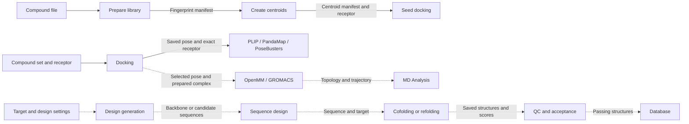

# Studio tool connections and acceptance evidence

The **Tool Validation** project (`db1c0f35f19847079eb3dfb29ce970a3`) contains small acceptance runs submitted through the paired MCP connection. The initial live baseline was `8edf4e5`. The matrix retains historical execution evidence and records the current canvas catalogue.

## Query the map from Studio

The authenticated `GET /api/v1/workflows/connections` endpoint and the read-only `tool_connections` MCP tool use the same catalogue as the **All tools** page and the same port rules as the canvas. The response is paginated with `offset`, `limit` and `total`.

| Look up | MCP arguments |
| --- | --- |
| A tile and its workflow modes | `{"view":"tiles","query":"Boltz-2"}` |
| Required and optional inputs | `{"view":"workflows","query":"library.prepare"}` |
| A canvas operation's input and output ports | `{"view":"operations","query":"md_analysis"}` |
| What can supply an MD trajectory | `{"view":"connections","operation":"md_analysis","direction":"incoming","artifact_type":"md_trajectory"}` |
| Which jobs can feed Vina or use its results | `{"view":"handoffs","query":"ligand.docking.vina"}` |

The standalone handoff view records reusable file and source-job routes. The audit snapshot below records the historical execution evidence with the exact jobs that exercised them.

## Execution and Results coverage

Each tile mode has a coverage row for live execution, MCP Results, Streamlit Results, earlier saved outputs and patched native replays. [Per-tile coverage](tool-execution-coverage.md)

- ScanNet and PeSTo ran on public 1IEP input. Their native residue tables rendered in Streamlit. A completed MaSIF-seed job supplied the surface and prediction artifacts through a remote MCP inspection.
- Boltz-2 produced a two-chain model. ipSAE, Biotite and Rosetta each returned one valid result on that saved model. ESMFold2 Fast returned a native structure through remote MCP inspection. Nesso-1 scored one compound and RosettaLigand returned one scored pose. Both ligand Results pages rendered their saved output.
- Sequence Composition initially failed because the selected chain's full sequence was in `protein_chains` and the candidate had no `binder_sequence`. The patched adapter reads the exact single selected chain's recorded sequence. A native replay scored the ten-residue chain.
- Surf2Spot initially failed before its engine started. The queue expected `detection`, while the worker created `hotspot-detection`. The patched queue and worker completed a native replay with a hotspot table and surface mesh.
- The follow-up jobs used Results-only collection. A read-only SQL check found zero observations associated with these runs in the Tool Validation project.
- The follow-up API, queue, QC and Results regression checks passed 68 tests. Ten optional QC-container tests were skipped in that suite. The native replay evidence is recorded in the coverage table.

## Catalogue and connection matrix

The rendered All tools page contains **95 tiles**. All 95 setup pages loaded their controls in an isolated Streamlit test. Every tile maps to a workflow available through MCP. The MCP setup endpoint returned valid parameter schemas for **123 workflows**. Some workflows share a tile or a submission endpoint, with parameters selecting the engine or mode.

The current matrix records **129** canvas operations and **4,866** typed port matches. All **95 tiles** and their modes have a canvas operation. Thirty-three new adapters use the registered workflow parameters and file contracts. SAbR is mapped to its existing operation. Graph validation checks required inputs, supported scientific modes, selection rules, and provenance. The `verified_handoffs` and `canvas_update.native_handoffs` sections identify runs that transferred recorded artifacts. A port match alone establishes wiring eligibility. [Connection matrix](tool-connection-matrix.json)

The adapter can read a saved target, candidate collection, compound set, fingerprint manifest, or prepared complex where a compatible input is declared. When wiring an MD job, supply ligand SDF chemistry and the ligand identifier alongside the prepared complex. A deferred multi-run candidate selector may require materializing its candidates before passing them to a standalone-tool adapter.

## Main test chains

Solid lines were exercised in native live runs in the test project. Dashed lines identify established artifact handoffs to exercise in their own acceptance runs. The JSON matrix gives the exact canvas ports where they exist.

| Producer | Required inputs | Key output | Consumer and handoff |
| --- | --- | --- | --- |
| Prepare library | ID/SMILES table or SDF, library name, external output folder | Library ID and fingerprint manifest | Create centroids consumes the exact produced manifest. |
| Create centroids | Fingerprint manifest and matching library ID | Centroid manifest | Seed docking also needs a receptor and docking box. |
| Docking | Frozen compound set, receptor, docking box and engine settings | Compound scores and poses | PLIP, PandaMap and PoseBusters resolve the source job and its pose. A selected pose can be prepared with its exact receptor for MD. |
| Complex preparation | PDB of the source complex and repair or trimming settings | Prepared complex, prepared receptor and repair report | MD needs the prepared complex, matching ligand chemistry in SDF and an exact ligand key. Docking can use the prepared receptor with a compound set and a docking box. |
| Surface and pocket analysis | Target coordinates | Residue or surface measurements and candidate pocket annotations | A downstream run must use the same target representation and explicitly select supported residues, a region or a docking box. The analysis reports retain their own provenance. |
| Design generation | Target sequence or structure and engine-specific settings | Backbone or designed sequence with candidate identity | Sequence design consumes a backbone where supported. Prediction consumes the resulting sequences and target context. |
| Cofolding or refolding | Sequences and any required target, template, ligand or MSA | Structure, confidence data and candidate records | QC and acceptance operate on the selected model and its measurements. |
| Filter and acceptance | Candidate records and criteria with declared metric units and direction | Passing, failing and unresolved decisions | Database admission requires a recorded acceptance decision and usable design structure for filtered designs. Unselected candidates remain available in Results. |
| Saved structure analysis | Exact saved design, complex or pose and tool-specific settings | Measurements, report and optionally a derived representation | Evaluations can attach to an eligible existing structure when the source identity resolves. The attachment preserves the evaluator and source job. |
| MD production | Prepared complex, force-field settings and simulation stages | Topology, trajectory and starting structure | MD Analysis consumes the production trajectory and topology. Analysis summaries can attach to the analyzed structure. |

## Observed behaviour

| Check | Evidence |
| --- | --- |
| MCP discovery and setup | 123 out of 123 registered workflow setup requests returned valid parameter schemas under the paired account. |
| Streamlit setup | 95 out of 95 tile routes rendered controls with empty starting inputs. Five tiles showed their required-input checks. |
| Vina execution | Two native one-compound jobs completed with an imatinib score and pose. The Results page loaded the saved ligand and score. |
| GNINA and Uni-Dock Pro | Both native jobs completed with one scored compound and a pose retrievable through MCP Results. |
| AutoDock-GPU | The live API rejected the tile's job name. A retry reached the engine, which produced a pose and reported positive scores, but Studio rejected the signed scores. The checkout accepts the job name and parses positive and negative scores. A native replay with the patched runner completed and saved a score and pose. |
| Docking analysis handoff | PLIP, PandaMap and PoseBusters each consumed the same Vina job through `source_job` and returned one valid scored record. |
| Boltz-2 execution | A one-structure Trp-cage request completed and returned its saved structure through Results. |
| Library handoff | Preparation processed a five-compound table. Centroid creation consumed its library ID and fingerprint manifest. Seed docking used the centroid manifest and a receptor to score one centroid and return its pose. The checkout declares the required external output directory in the preparation schema. |
| Complex Preparation | The public 1IEP input produced a prepared complex, receptor and preparation report through the tile with repair disabled. |
| Results-only policy | The manual Vina run generated scientific Results with zero ligand observations in Database. |
| Automatic docking admission | The live Vina opt-in also returned zero ligand observations for a new ligand. The code fix admits explicitly opted-in successful docking compounds with saved poses. Replaying the native result into an isolated SQL database produced one ligand observation and a byte-identical saved pose. Regression cases cover failed compounds, missing poses and Results-only mode. |
| MCP job references | The live MCP adapter returned 404 for a qualified `task-group/run-id` Results reference. The checkout normalizes this form to `local:task-group:run-id`. The patched MCP adapter used the qualified reference to open the live Boltz-2 Results, candidate table and structure viewer layers. |

## Using the matrix for additional validation

1. Start with one small input per artifact family. Submit through the paired MCP account and reuse the exact upstream result or manifest for each consumer. Check the persisted job receipt, output files, and Results rendering.
2. Where the canvas supports a handoff, exercise the same chain as a saved pipeline. Verify the selected source IDs and formats and test a missing or incompatible input. Include a local and a remote worker where the workflow supports both placements.
3. Run the Database admission controls separately. For docking, check Results-only and explicit admission with an unregistered compound, a failed score and a missing pose. For design, check passed, rejected, unresolved and explicitly selected candidates. For post-analysis, check attachment to the exact admitted parent and the same analysis with a Results-only source.

Setup verification establishes MCP access to a workflow contract. The listed native runs establish execution and Results for those configurations. A workflow with only setup evidence still needs its own runtime, Results and admission checks. Live runs used release `8edf4e5`. Follow-up fixes were verified in isolated environments using the patched checkout. [Execution coverage](tool-execution-coverage.md)

## Native follow-up

| Workflow | Finding and verification |
| --- | --- |
| Sequence Composition | Candidate preparation now uses a single explicitly recorded protein chain when the candidate has no binder role. The exact two-chain case passed through the patched MCP adapter, API and worker, scoring the recorded 10-residue chain B. |
| AutoDock-GPU | The patched submission accepted the job name, and the native run saved one imatinib pose with the engine's reported score of +32.42 kcal/mol. The explicit Database opt-in created one SQL observation and saved a byte-identical copy of the native PDBQT pose. |
| Surf2Spot | The patched API submitted the correct worker task group. The native worker completed and saved a hotspot table, mesh and viewer artifacts. |
| Automatic MSA placement | The live ESMFold2 Full and Boltz-2 attempts selected workers without the ColabFold helper image. Placement now uses the engine's effective MSA settings to check for the exact image when server search is enabled. ESMFold2 Full and Protenix V2 succeeded in separate single-sequence live requests. |
| Boltz-2 rootful Docker | The native adapter created input aliases owned by root, which blocked host-side output collection. A replay on PC004032 ran the container with the worker's UID and GID and returned both models with zero container failures. |
| Combined Surface Analysis | PeSTo and Surf2Spot used an absolute model path from another workstation. The workflow now uses the configured reference directory and advertises all four tools and their model requirements for placement. The replay on PC004033 completed PeSTo, ScanNet, Surf2Spot and MaSIF with 13 artifacts. |
| Interface Clustering | A live cohort with two different predicted target conformations lacked a verified shared target. The workflow rejected both inputs and recorded the reason. An isolated native replay with identical target coordinates and numbering returned cluster assignments and contact maps for both inputs. |
| Structure preview | The generic Results viewer assumed that its B-factors contained pLDDT even for inverse folding and sequence analysis outputs. The preview now colors its cartoons by chain. The dedicated Boltz-2 view still displays its recorded pLDDT. |

The follow-up suite passed 297 tests with 10 optional QC container tests skipped. Six Streamlit Results checks opened saved native outputs in the patched app. The patched native worker replays above ran their installed Docker images. The execution matrix records the live attempts and patched retests with separate run references.

## Molecular dynamics and additional tile runs

| Check | Observed result |
| --- | --- |
| Validation & Acceptance | The live request read two saved Boltz-2 models without a new prediction. Both models were evaluated and rejected by the explicit ipTM test criterion. Their source candidate IDs were preserved. |
| PocketXMol and PocketFlow | The first attempts failed on a remote worker without the required images. PocketFlow also lost its SDF path in the bundle. Local retries both produced saved molecules. The checkout stages SDF and pharmacophore files and checks ligand-generator image and model availability before dispatch. |
| OpenMM production registration | The engine completed and saved a two-frame trajectory. Studio then treated the inline ligand PDB record as a filename. The patched finalizer registered the saved native trajectory and reports. Source selection now reads the native production result and resolves only its recorded trajectory and compatible topology. |
| GROMACS production and handoff | AmberTools failed on an SDF with implicit hydrogens. The patched preparation adds explicit hydrogens without replacing the heavy-atom pose. Native GROMACS completed equilibration and production. MD Analysis used the bonded solvated Amber topology recorded during GROMACS preparation and processed all three saved frames. |
| MD Analysis | The live API could not authorize a Results path because of a malformed catalog query. It also routed standalone MD Analysis through a docking-input validator. Once those paths and checksum serialization were fixed, a patched MCP submission analyzed both OpenMM frames and saved RMSD and radius-of-gyration time series, RMSF, and residue contacts. Source trajectory and topology digests were unchanged. |
| MD Analysis canvas | The saved MD source passed its exact trajectory and topology to the analysis node and on to Results. The pipeline reports one linked MD analysis. |
| AlphaFold2 Initial Guess | The initial test supplied an invalid mode, which passed generic validation on the deployed release. The valid complex-template retry returned one model. The checkout exposes the supported mode names in its API contract. |
| ColabFold | The selected remote worker had the image and lacked its multimer parameter cache. Automatic placement now requires the five expected multimer parameter files in the standard reference cache. The live retry on the workstation with the installed weights saved one model and returned it through MCP. The cold JAX compilation took about 18 minutes with the two-CPU test allocation. |
| Workstation liveness | A workstation could report that it was unavailable while new references were being fingerprinted. The status pulse now publishes only already-verified hashes for current files. Catalog synchronization still computes them, and dispatch still checks the required hashes. |

The focused suite passed 198 tests with three optional MDTraj checks skipped in the Studio environment. The native MDTraj container ran the saved OpenMM trajectory. Twelve headless Streamlit Results checks passed on native outputs. This batch used Results-only policy, and the producing workstations had zero SQL observations for the 19 runs checked.

## Ligand generation and structure prediction

| Check | Observed result |
| --- | --- |
| Ligand generation | Live jobs returned saved compound sets through MCP for LDDM, PGMG, FLOWR.root, DrugRPG and PFM. A reduced-step conDitar and paOPT trial yielded zero valid compounds. The retries used the default diffusion settings and saved two and four compounds, respectively. |
| OMTRA | The installed checkpoint supports protein plus pharmacophore conditioning. The protein-only job requested a task absent from that model. Studio now selects the checkpoint for the requested mode and includes it in workstation placement requirements. An isolated replay using the upstream protein-conditioned checkpoint saved two valid compounds from four samples. The protein-only checkpoint is required on any production workstation assigned that mode after deployment. [Upstream OMTRA model weights](https://github.com/gnina/OMTRA#model-weights) |
| Prediction engines | AtlasFold, OpenFold3 OpenBind-0 and RFD4 Structure Prediction returned one saved model each through MCP. The first RFD4 trial used 20 steps and the native worker rejected it. The API now checks the supported range before queueing. The 60-step live retry completed. |
| Mol-1 | The native worker completed inference and Studio failed to write a derived PAE file into a container-owned output directory. The patched worker saved one model and its linked 20 × 20 PAE matrix on PC004033. The original coordinate file remained container-owned. |
| OpenFold3 Results viewer | The native structure contained 153 atoms and omitted the mmCIF occupancy field. The patched Results viewer supplies the missing display value in a temporary copy. The saved structure and its checksum were preserved. |
| LDDM to Vina | The live API failed to accept the generated compound set by source job. The patched MCP workflow used the exact saved LDDM compound set, scored one compound, saved its pose and recorded the job dependency. The source artifact checksum was unchanged. This handoff was verified in an isolated API workspace. |
| Database policy | The 15 live runs used manual collection. Read-only SQL checks across all three database copies found zero molecule observations associated with those runs. |

The focused workflow and API suite passed 284 tests. The confidence and display suite passed 44 tests, the RFD4 preflight check passed separately, and 12 headless Streamlit Results checks passed on saved native outputs. The Results checks include the isolated Mol-1 and OMTRA replays. The patches were verified from the checkout in isolated workspaces.

## Candidate refolding and MSA reuse

| Check | Observed result |
| --- | --- |
| Protein MSA source | The prediction tiles and target preparation paths use the shared resolver. A matching uploaded or saved alignment supplies the input. A cache miss uses the ColabFold server through the alignment-only Docker client. Older local-search settings in the AF3 JAX and ESMFold2 cofolding requests resolve to the server policy. The separate AlphaFast benchmark runner still has its own local data pipeline. |
| Live ColabFold check | A public villin fixture returned a 5,145-row alignment from the server. A second request with the same query used the saved full alignment and made no server request. An isolated regression also verified that a mismatched cached query is rejected before search. |
| Candidate handoff | Native OpenFold3, Protenix, Protenix CLI and RosettaFold3 each refolded both members of the same saved Boltz-2 cohort through MCP source-job references. RosettaFold3 failed at one recycle and succeeded at two. The candidate-refolding API now validates that lower bound. |
| Workstation prerequisites | The candidate refolding workflows now declare their image and default model inputs for placement. They resolve default reference files relative to the worker's configured directory. The patched RF3 trial on PC004032 mounted its checkpoint from that worker's reference directory. |
| BoltzGen Fold | The live candidate-refolding path lacked the cache mount and the rootful worker could not read the native archives. The patched replay saved both cohort structures on PC004032. The target-template path saved a structure on PC004033 and, after the ownership fix, its worker read a 30 × 30 PAE matrix. |
| AF3-family prediction | The OpenFold3 JAX, AF3 PyTorch and ColabFold preview tiles returned saved structures through MCP. On the RTX 5090, JAX 0.11.1 omitted the device name from its Triton registry. Registering the GPU exposed a second failure: a kernel required 108 KiB shared memory per block, while the card supports 99 KiB. The replacement container registers the device and selects XLA for the affected operations. |
| OpenFold3 JAX production retest | The same image fingerprint was installed on PC004032, PC004033 and the RTX 4090 coordinator. Both RTX 5090 workers completed single-sequence OpenFold3 P2 validation jobs through MCP and returned one sequence-verified model each. The isolated retests verified a 153-atom structure and a finite 20 × 20 PAE matrix on all three machines. Both workers are eligible for MSA-enabled placement after installation of the ColabFold alignment client. The two live jobs used manual collection and created zero molecular-library observations across the three workstations. |
| BinderScope and Database | One authenticated MCP request in an isolated database ran the native BinderScope worker and attached an evaluation to the selected structure digest. Submission and import retries still produced one observation. Read-only checks found zero SQL observations for the 12 live runs that used manual collection. |

The focused suite passed 177 tests with two optional BinderScope container checks skipped in that suite. The separate authenticated BinderScope MCP check ran the native image. Ten headless Streamlit Results checks passed on saved native outputs.

## Design and sequence tools

| Check | Observed result |
| --- | --- |
| Live MCP execution | Eleven additional tiles returned fresh results. AbMPNN, BoltzGen Generator, ESMFold2 Binder Design, Kejia IDR Binder, Peptide Trap, Protpardelle-1C, PXDesign, RFD4-Proteina, RFdiffusion β-pairing, RFdiffusion3 and RFpeptides each saved one candidate. |
| Source-job handoffs | ProteinMPNN consumed the saved RFdiffusion3 backbone and Sequence Clustering consumed the saved AbMPNN candidate. Both child results retained the exact parent candidate ID. |
| RFdiffusion fixed-length input | Hydra converted an unquoted fixed-length contig into an integer and the engine stopped. The revised command passes it as a string. A native replay of the same request saved one backbone. |
| Proteina-Complexa Generator | The native run generated one candidate, but an image-only `community_models` symlink caused Results registration to fail. The container adapter now cleans up that link. A native replay registered the candidate and rendered its Results page. |
| BoltzGen Generator on rootful Docker | PC004033's first job used a hard-coded cache location and saved a private archive owned by root. The revised adapter mounts the configured reference cache and runs generation with the worker's user ID. The replay saved a readable NumPy archive and one candidate. |
| Placement requirements | AbMPNN now declares its actual image and checkpoint. BoltzGen declares the runtime selected by its MIMOSA setting. ESMFold2 Binder Design declares its image and model directory. RFdiffusion3 no longer requires the classic RFdiffusion model directory. |
| Results and collection | All 15 live jobs were inspected through MCP. The three workstation databases contained zero matching molecular-library observations. Sixteen headless Streamlit checks rendered the saved results, including the three isolated native replays. |

The focused regression suite passed 218 tests. The app patches were verified in the checkout and isolated native runs. The official AlphaFold3 weights have earlier saved evidence. The fresh check exercised request validation, and the worker still requires explicit acceptance of the weight terms before execution.

## Live follow-up on the ten remaining tiles

| Tile or check | Production MCP and patched verification |
| --- | --- |
| BindCraft2 and BindCraft2 Generator | Both jobs stopped before inference because the scheduler rejected the recorded `python` executable. The checkout resolves this descriptive command through the worker's interpreter. Native replays on PC004033 and PC004032 each ran one trajectory and recorded a rejection. |
| BinderScope | One live assessment scored the public 1MEL fixture. The single SQL observation links to the selected source group and exact structure representation. The same observation was visible on all three workstations. |
| BoltzGen and MIMOSA BoltzGen | Full BoltzGen generated and refolded one candidate, with two stage records. MIMOSA BoltzGen recorded a backbone integrity rejection and zero accepted designs. Streamlit now shows the rejection in the normalized candidates table. |
| RFantibody and MIMOSA RFantibody | Both completed on the coordinator. An initial MIMOSA dispatch to PC004032 dropped its structure input. The patched coordinator staged the structure and the remote native replay verified both input digests and saved a backbone and RF2 prediction. |
| Proteina-Complexa | The engine finished generation and refolding. Results registration rejected a dangling link to a container-only model directory. The native replay registered both candidate stages with the checkout's link cleanup. |
| MD Analysis | Production API validation stopped at a malformed job catalog authorization query. An authenticated replay with the checkout fix analyzed both frames from the same saved topology and trajectory bytes. Streamlit opened the resulting reports and artifacts. |
| RFdiffusion length range | Production generated a 45-residue backbone from the requested 40–45 range. The old normalization reported 70–100. The checkout records the observed length and retains the original contig. |
| ProteinMPNN to Sequence Composition | Production MCP passed one saved 40-residue candidate to Sequence Composition. The result scored one sequence and retained the exact ProteinMPNN parent candidate ID. |
| AlphaFold3 JAX with official weights | Production validated the request schema during this batch. The subsequent official-weight run is recorded below. |

The focused suites passed 223 tests and nine headless Streamlit checks opened saved Results. The BinderScope assessment was the only result observation from this batch in the molecular library. Production ran on `8edf4e5`. The application fixes described here were verified in the checkout. [Run coverage](tool-execution-coverage.md)

## Final fifteen tile retests

Official AlphaFold3 JAX ran through production MCP and saved a 20-residue structure and a finite 20 × 20 PAE matrix. The account's existing acknowledgment matched the current upstream terms and prohibited-use policy. The same acknowledgment is stored on the coordinator and both compute workstations. In the patched API, submissions through either official AlphaFold3 route inherit the account's current acknowledgment. The regression check covered missing acceptance, repeated submission without a new flag, and the exact settings passed to the worker. [Official AlphaFold3 model-weight terms](https://github.com/google-deepmind/alphafold3/blob/main/WEIGHTS_TERMS_OF_USE.md)

The other retests used the patched checkout, authenticated MCP and the installed native runtimes in isolated Studio workspaces. Each used public test fixtures and manual collection. The OpenMM-to-MD Analysis handoff verified the same trajectory and topology digests before analysis. GROMACS finished its ten-stage preparation equilibration and saved a production trajectory. Interface Clustering returned two contact maps for a shared target. Full Proteina-Complexa retained both generated and refolded candidate records. Mol-1 saved a structure and a finite 20 × 20 PAE matrix. Both BindCraft2 tests recorded an executed trajectory and zero accepted designs.

Surface Analysis completed PeSTo, ScanNet, Surf2Spot, and MaSIF-seed and retained 13 artifacts. Standalone Surf2Spot also completed. BoltzGen Fold refolded both saved Boltz-2 candidates and retained their structures and PAE files. OMTRA saved two compounds using the protein-conditioned checkpoint in the test workspace. Production workers assigned that mode still need the appropriate checkpoint.

The checkout restores LocalFold's per-model sampling defaults in the shared validation and placement code. The BindCraft2 settings table now sends one display type to Streamlit for mixed numeric and textual values. The focused integration suite passed 216 tests. [Run coverage](tool-execution-coverage.md)

## Regression checks

- The isolated contract, API, scheduler, pipeline, Database and tile suite passed **421 tests** with four skips and four warnings. The warnings came from DSSP calculations on synthetic acceptance fixtures.
- Twelve MD analysis tests passed in the installed OpenMM environment, including the three trajectory checks skipped in the main Studio environment. These checks cover DCD timestamps, periodic imaging, and saved analysis outputs. They used fixture trajectories.
- The focused workflow-mode suite passed 35 tests with nine deselected. It includes save, list and validate checks for the native, comparative and modular modes under a real test-project membership. The corrected fixture initializes the API before mocking job registration, so test order does not replace the API's job marker with a no-op.
- The candidate-set suite passed 28 tests. Its optional Chaperone integration test was skipped because that package is absent from the Studio environment used for the suite.
